# ST10389916_AAPD7112_POE

## Municipal Service Portal

A Windows Forms application for reporting municipal issues and viewing
local events and service request status.

---

## Application Overview

The application provides users with three main options:

- Report an Issue
- Local Events and Announcements
- Service Request Status

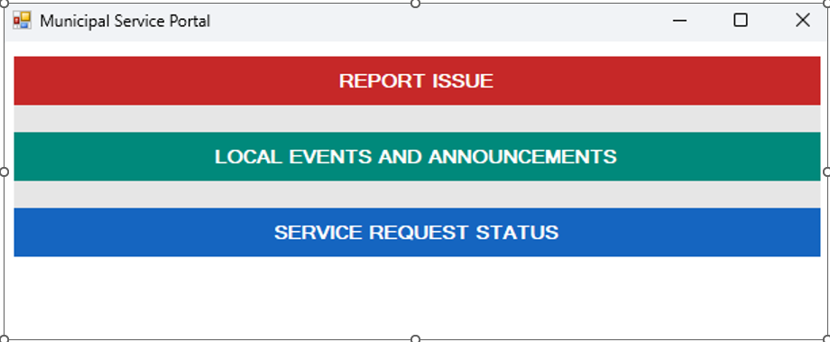

---

## Report a Municipal Issue

Users can report a municipal issue by providing a location, selecting a
category, and entering a description.

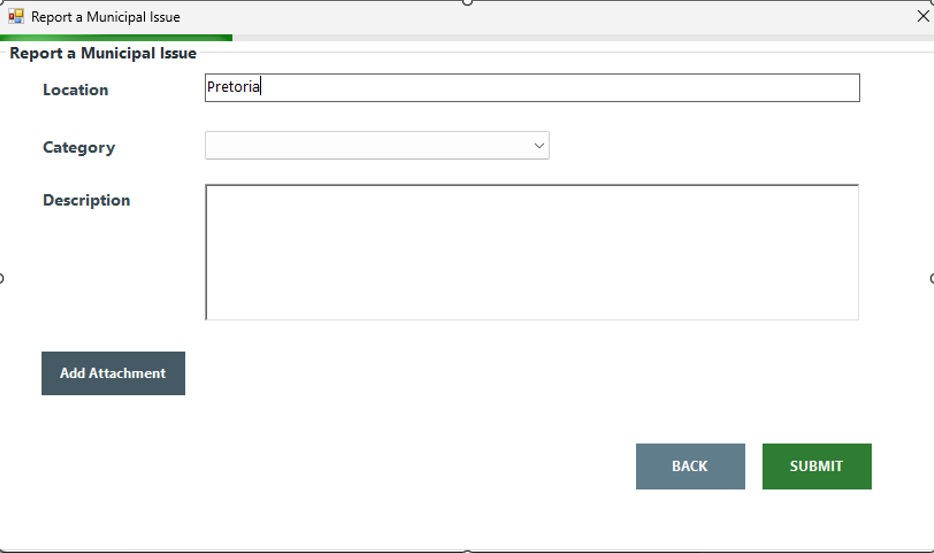

### Issue Details

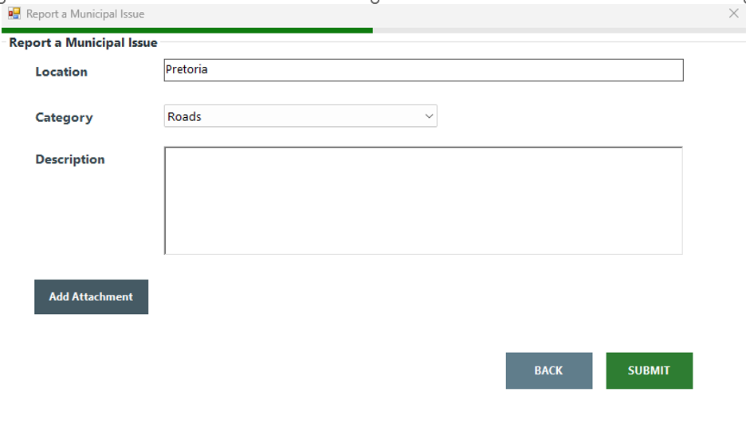

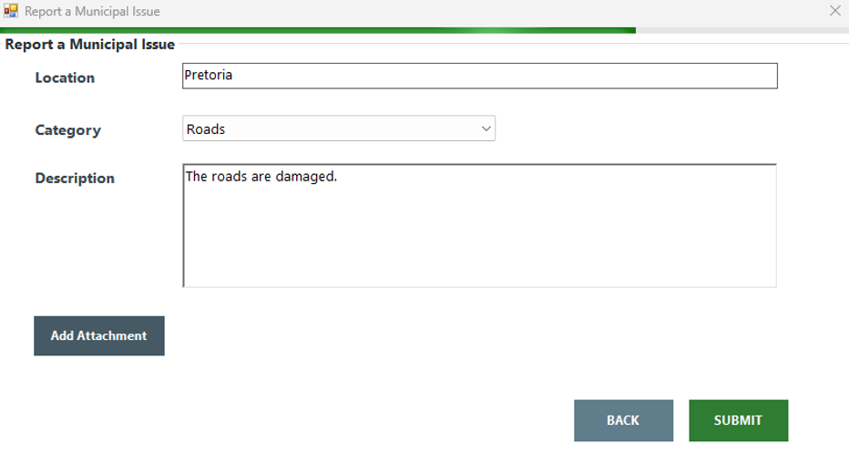

### Successful Submission

After submitting an issue, the system confirms that the entry was saved.

### File Attachment

Users can also attach supporting files to their issue reports.

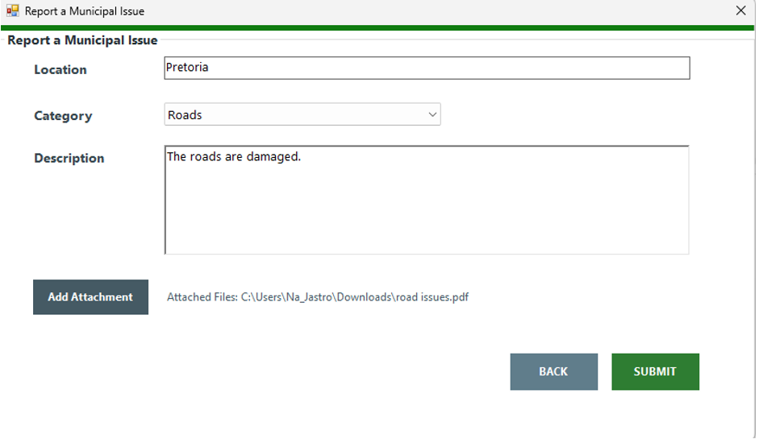

---

## Development Screenshots

### Main Application

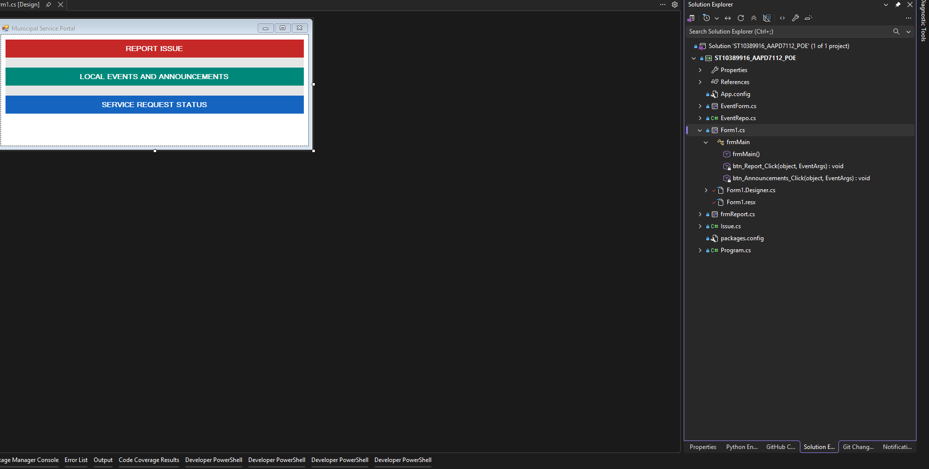

### Event Form Code

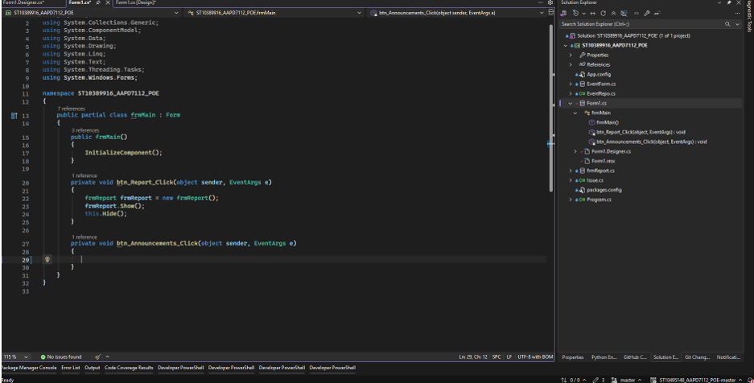

### Report Issue Form

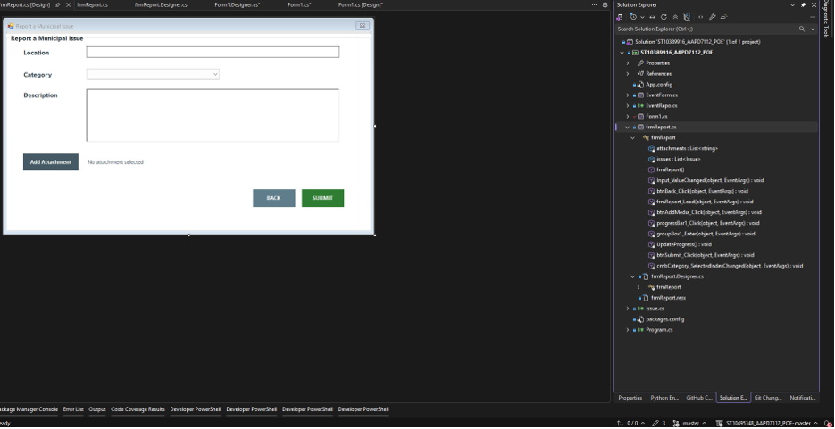

### Application Logic

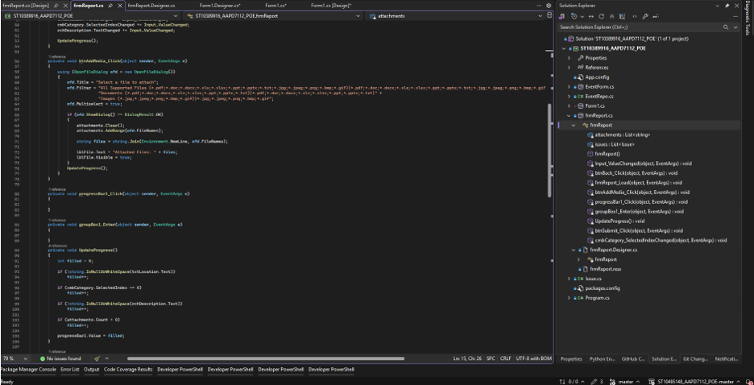

### Additional Implementation

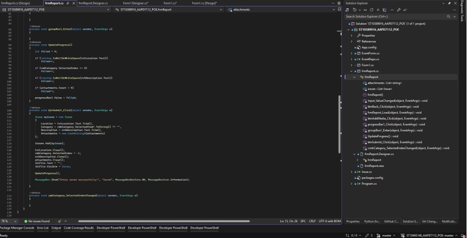

### Source Code

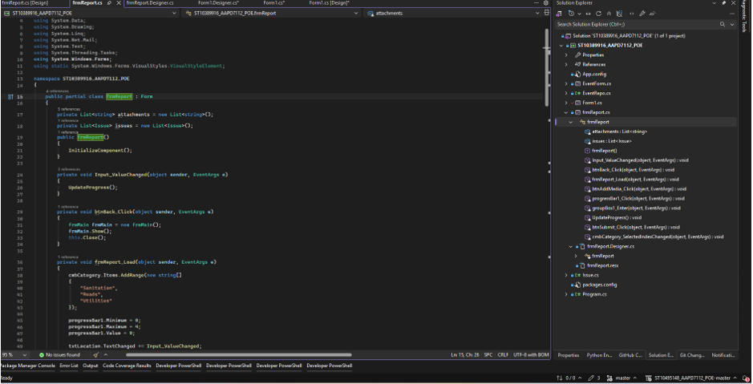

---

## Technologies Used

- C#
- Windows Forms
- MaterialSkin
- .NET
- Visual Studio

---

## GitHub Repository

[View the source code](https://github.com/Na-Jastro/ST10389916_AAPD7112_POE)
