# ST10389916_AAPD7112_POE

## Municipal Service Portal

A Windows Forms application for reporting municipal issues and viewing
local events and service request status.

---

## Application Overview

The application provides users with three main options:

- Report an Issue
- Local Events and Announcements
- Service Request Status

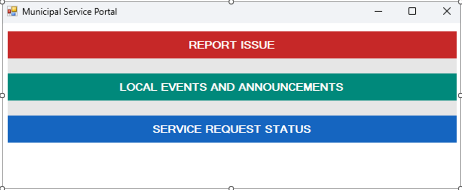

---

## Report a Municipal Issue

Users can report a municipal issue by providing a location, selecting a
category, and entering a description.

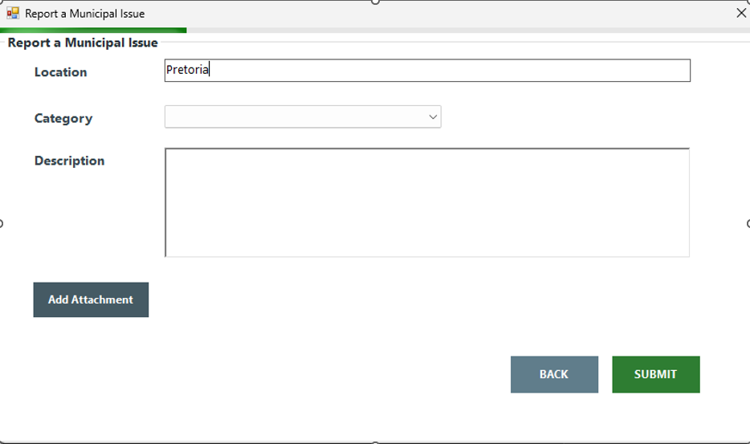

### Issue Details

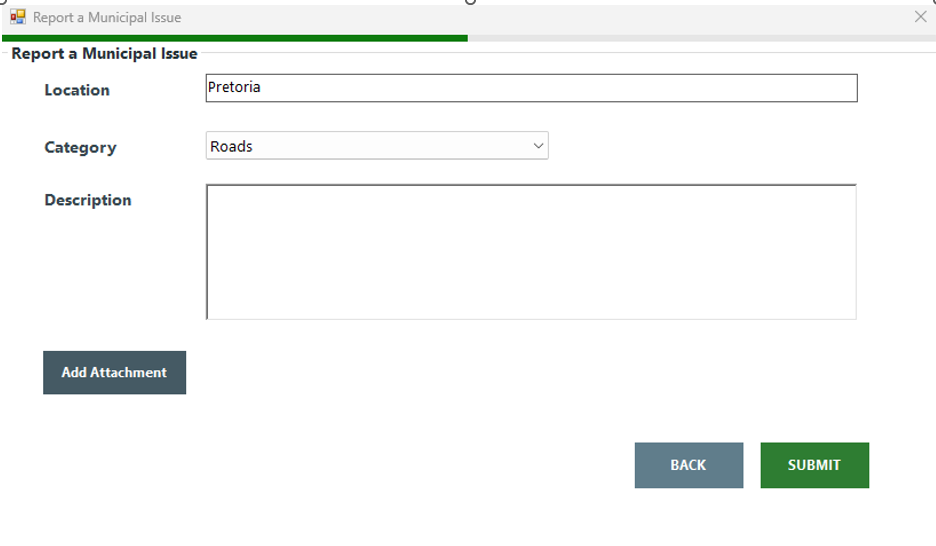

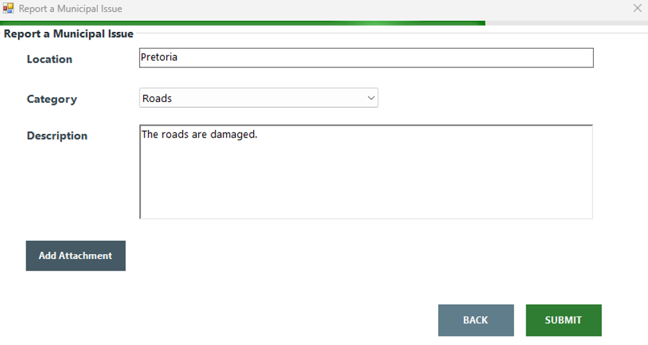

### Successful Submission

After submitting an issue, the system confirms that the entry was saved.

### File Attachment

Users can also attach supporting files to their issue reports.

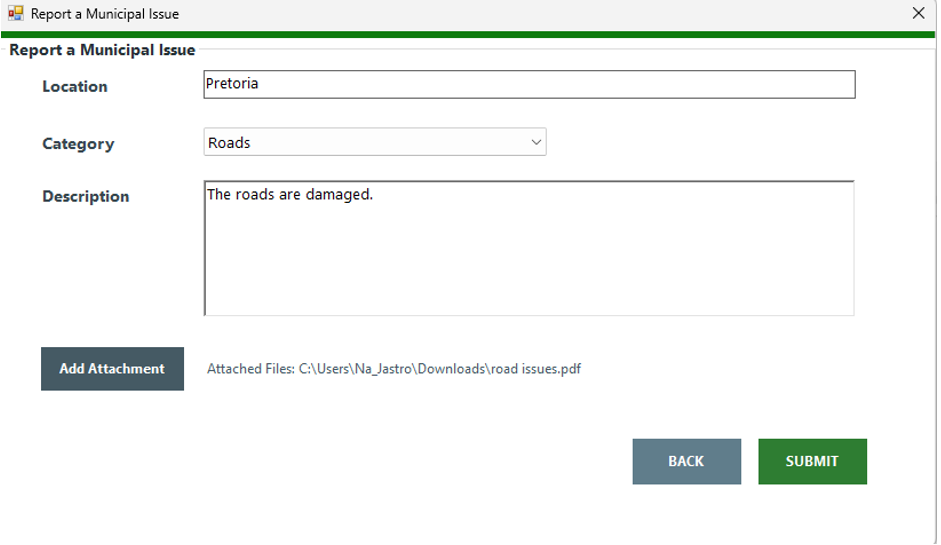

---

## Local Events and Announcements

Users can search and browse local events and announcements based on categories and dates.

### Event Search by Category

The application displays events filtered by category with search functionality:

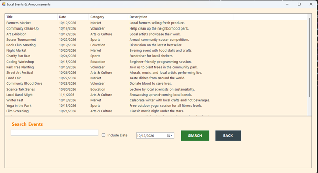

### Multiple Event Results

When searching for events, multiple results are displayed in a detailed list view:

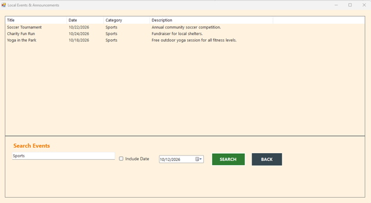

### All Events Display

The complete event listing shows all upcoming local events organized by title, date, category, and description:

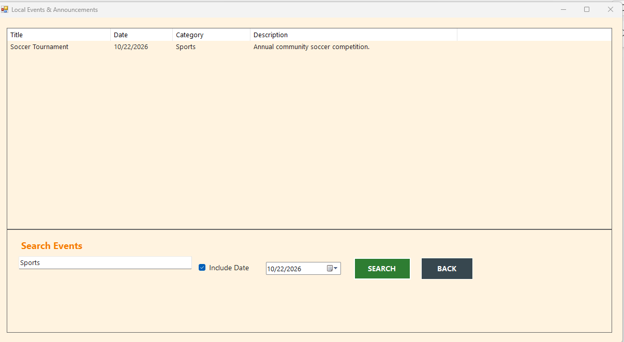

### Features:
- **Search by Category**: Filter events using the search box
- **Date Filtering**: Use the "Include Date" checkbox to filter by specific dates
- **Recommendations**: View related events based on search history
- **Aesthetic Display**: Color-coded interface with easy-to-read event details

---

## Development Screenshots

### Main Application

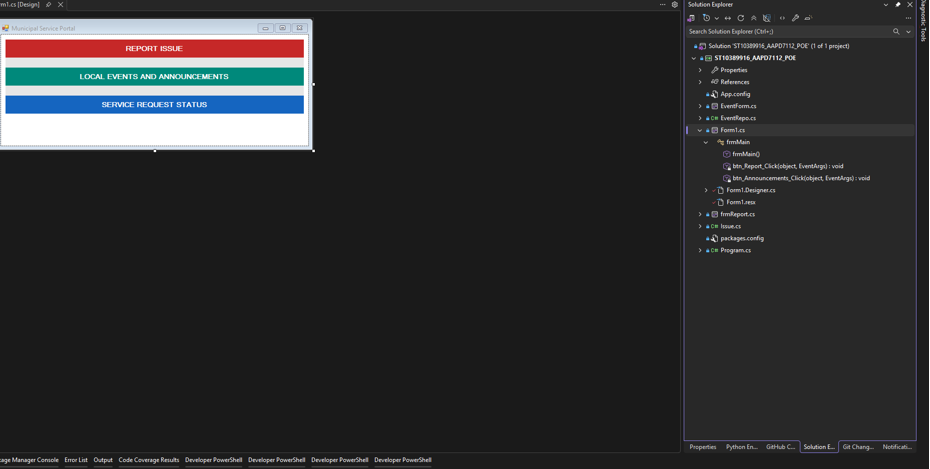

### Event Form Code

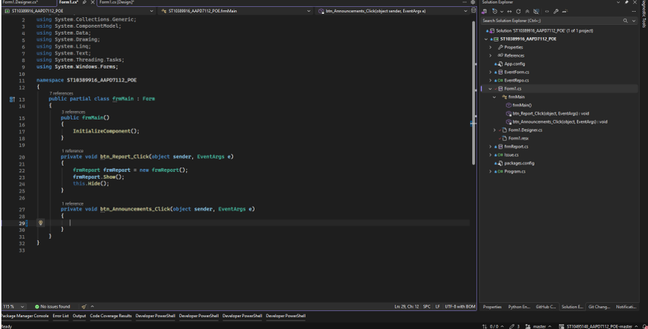

### Report Issue Form

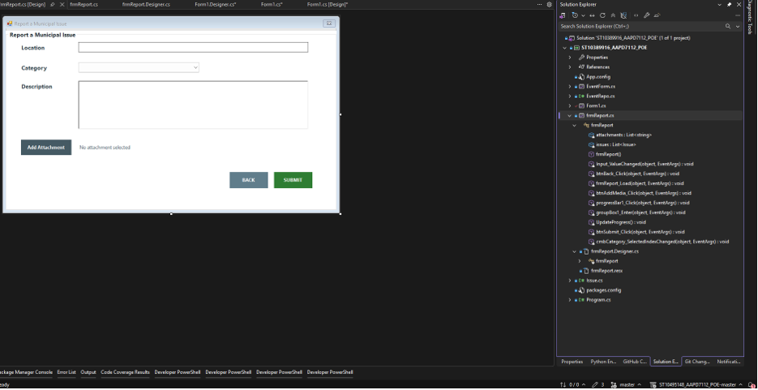

### Application Logic

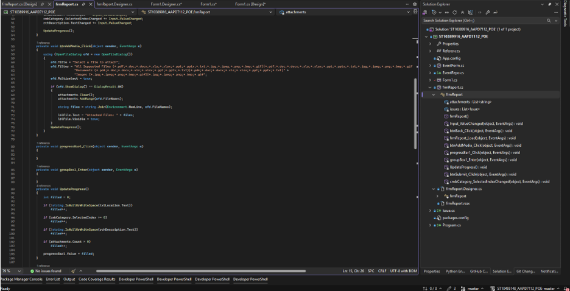

### Additional Implementation

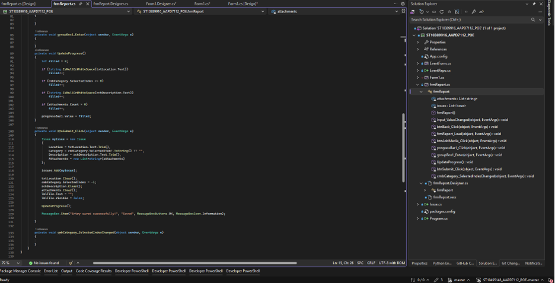

### Source Code

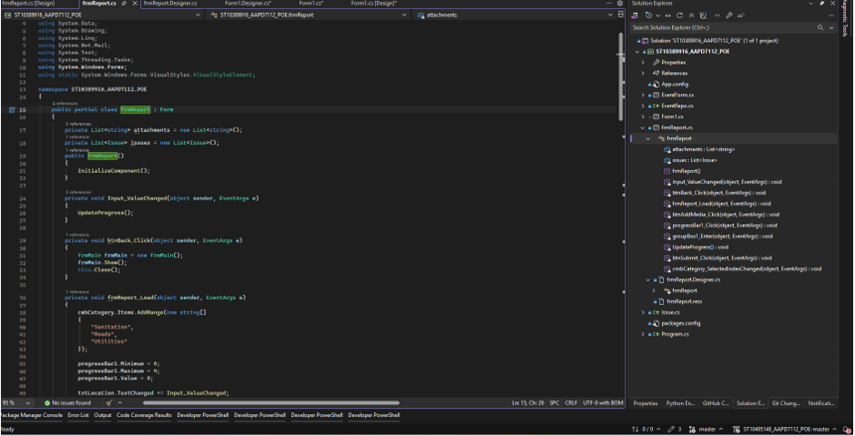

---

## Task 3: Service Request Status (Advanced Data Structures)

This task implements the Service Request Status feature as a Windows Form where users can:

- View a well-organized list of submitted service requests and statuses.
- Track a request using a unique request identifier (for example: `SR-1001`).
- Analyze request flow and optimization outputs powered by custom data structures.

### Task 3 Feature Screenshots (Placeholders)

> Add screenshots after running the Service Request Status page:

---

## Task 3 Implementation Report

### How to Compile, Run, and Use

1. Open `ST10389916_AAPD7112_POE.slnx` in Visual Studio.
2. Build the solution.
3. Run the application.
4. On the main menu, select **SERVICE REQUEST STATUS**.
5. Use the page functions:
   - **TRACK** to search by unique request ID (BST lookup).
   - **SORT PRIORITY** to view high-priority requests first (AVL tree ordering).
   - **SORT ETA** to view quickest expected resolution first (Min-Heap ordering).
   - Review category hierarchy (Basic Tree) and network optimization summary (Graph traversal + MST).

### Data Structures Implemented and Their Role

#### 1) Basic Tree
- Used to represent hierarchical organization: `Service Requests -> Category -> Request/Status`.
- Contribution: Provides a clear structural view for grouped service data.

#### 2) Binary Search Tree (BST)
- Stores requests by unique `RequestId`.
- Used by the track-by-ID function for efficient search.
- Contribution: Faster request retrieval than scanning full lists.

#### 3) AVL Tree
- Self-balancing tree keyed by priority level.
- Used to produce stable, sorted priority output.
- Contribution: Maintains efficient insert/search performance with balanced height.

#### 4) Red-Black Tree (Conceptual Placement)
- For this submission, balancing behavior is demonstrated through AVL for ordered status operations.
- Recommended extension: add a dedicated Red-Black Tree for large, frequently updated status streams where insertion/deletion rebalancing is required.

#### 5) Min-Heap
- Stores requests by `EstimatedDays`.
- Used to extract nearest-resolution requests first.
- Contribution: Efficient prioritization for scheduling service teams.

#### 6) Graph + Graph Traversal
- Represents ward connectivity and relationships between service zones.
- BFS traversal shows visit order from a selected ward.
- Contribution: Supports route planning and visibility of connected areas.

#### 7) Minimum Spanning Tree (MST)
- Prim-based MST cost is calculated from the service-zone graph.
- Contribution: Demonstrates low-cost network planning for municipal operations.

---

## Task 3 Project Completion Report

### Completion Summary

Task 3 has been integrated into the municipal portal by adding a dedicated **Service Request Status** page, custom data structures, and tracking/sorting operations. The feature now complements the existing Issue Reporting and Local Events modules.

### Challenges and How They Were Overcome

- **Challenge:** Integrating multiple advanced structures without breaking existing forms.
  **Solution:** Added isolated service request model/repository classes and connected through a single new form.

- **Challenge:** Keeping search and sorting behavior understandable to users.
  **Solution:** Mapped each action button directly to one structure-backed operation.

- **Challenge:** Balancing technical depth with clean UI behavior.
  **Solution:** Kept structures in backend classes and exposed concise outputs in form controls.

### Key Learnings

- Applying data structures to real UI workflows improves both performance and design clarity.
- Separating data logic from forms increases maintainability and testability.
- Graph and MST outputs provide practical optimization insights for municipal routing scenarios.

---

## Technology Recommendations

1. **SQLite (local persistence)**
   - Benefit: Stores requests/events between app sessions.
   - Compatibility: Works well with .NET Framework Windows Forms.

2. **Entity Framework 6**
   - Benefit: Cleaner data access layer and easier CRUD operations.
   - Compatibility: Mature support for .NET Framework 4.7.2.

3. **LiveCharts or OxyPlot**
   - Benefit: Visual dashboards for status trends, category volume, and SLA progress.
   - Compatibility: Integrates into WinForms with minimal disruption.

4. **Serilog + file sink**
   - Benefit: Structured diagnostics for debugging and maintenance.
   - Compatibility: Lightweight and straightforward for desktop apps.

---

## Technologies Used

- C#
- Windows Forms
- MaterialSkin
- .NET
- Visual Studio

---

## GitHub Repository

[View the source code](https://github.com/Na-Jastro/ST10389916_AAPD7112_POE)
